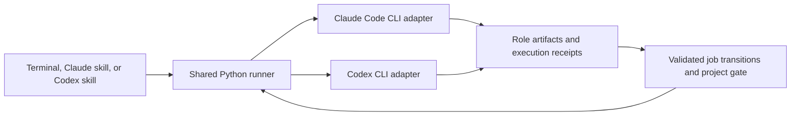

# Design

The factory separates the workflow from the coding agent that executes a step.
A Python runner chooses a CLI profile for each role. Claude Code and Codex are
adapters behind the same execution interface; subscription login stays inside
the installed CLIs.

## Execution

`factory/lib/runner.py` owns scheduling and the intake → spec → build → gate →
review → approve loop. `factory/bin/job` is the only writer of job.json and owns
GitHub transition effects. `factory/bin/gate` runs the main checkout's checks
inside the job's worktree and rejects modifications to protected paths.
It is the only place the full checks run: the builder runs fast checks and the
tests covering its change, and leaves the full suite to the gate.

A role gets its shared prompt, explicit paths, job/round identifiers, and the
required output file. Each attempt starts a fresh CLI session. Earlier specs,
build logs, feedback, decisions, and reviews carry context between providers.
Native session IDs are recorded for diagnosis; cross-provider recovery does not
attempt to resume a provider's private conversation.

The builder edits and verifies code, then writes build.md. The runner commits
explicit changed paths, pushes only the assigned branch, and opens its draft PR.
A failed gate always sends the job back to the builder: checks are never a
reason to stop, and the builder must fix every failure, including flaky tests
outside its change, at the root cause. Unbounded rounds need a no-progress
guard because coding CLIs bill against a subscription. The gate records
`check_streak` in job.json: consecutive failed gates and, of those, how many
ran on the same commit as the failed gate before. When `unchanged` reaches
`max_stalled_rounds`, or `failures` reaches an optional `max_check_rounds`,
`job advance` accepts only needs-human. A passing gate or human feedback clears
the streak. Check-fixing rounds extend `round_limit` by one, so they don't use
up the `max_rounds` budget for requested review changes.

Reviewers run in parallel once the gate passes. The approver escalates sensitive
changes using the project-specific rules in its prompt. An approval triggers
base-branch synchronization, another gate, a push, and GitHub's merge command.

## Workflow

The role prompts adapt Matt Pocock's engineering skills to an unattended,
issue-driven pipeline:

| Stage | Practices |
|---|---|
| intake | grilling in rounds (design tree, frontier, recommended answers), triage's already-built and `.out-of-scope/` checks, settling domain terms |
| spec-writer | agent brief (simple) or design spec (complex): deep modules, test seams, vertical slices, prefactor, glossary and ADR changes |
| builder | test-first vertical slices at the spec's seams; for bugs, a red feedback loop, then a regression test, then the fix |
| reviewer-code | separate Spec and Standards axes, test quality, module depth, glossary terms, code-smell baseline as judgement calls |
| reviewer-ui | one browser session for both UX (flow, states, accessibility, mobile) and visual design (theme, spacing, consistency) |
| approver | spec and test-first evidence, merge danger (one-way or two-way door, blast radius), follow-ups |

Interactive steps become files and issue comments. Only the builder edits
source, so glossary (`GLOSSARY.md`, or an existing `CONTEXT.md`) and ADR
updates are spec requirements the builder carries out. Architecture surveys are
not a stage: complex specs may require an in-scope prefactor, and out-of-scope
deepening opportunities are reported as follow-ups without opening issues.

### Tracks

intake.md carries `TRACK: simple | complex`. The runner passes the track to
every later role, whose prompt has the matching instructions; the stage graph,
gate and reviewer routing are the same for both. `simple_track_risks` (default
`["low"]`; `high` is never allowed) lists the risks that may take the simple
track, and the runner refuses an intake that puts other work there. The track
is recorded in job.json's `intake` field.

### Grilling on the issue

A NEEDS-INFO intake is one grilling round. `job advance <id> needs-info` posts
everything below intake.md's header as `### Factory grilling: round k` with a
fixed footer on how to answer, and adds the needs-info label. `job queue`
reports the job as waiting until the issue's author or the operator comments
after the factory's last comment. The next run moves it back to intake, which
archives intake.md as `intake-k.md`, refreshes issue.md with the answers, and
runs intake again. Each prompt states the grilling round and whether questions
are still allowed; after `max_grill_rounds` question rounds, the runner refuses
another NEEDS-INFO, so intake must accept with its recommended answers or
reject. job.json's `intake.grill_round` is derived from the archived rounds.

## Configuration

Profiles contain `cli`, optional `model`, and optional `reasoning_effort`.
`steps` selects profiles for intake, spec-writer, builder, and approver.
`routing` supplies reviewers by risk; `surface_reviewers` adds UI or security
reviewers. The UI reviewer covers both UX and visual design in one browser
session. All selected roles resolve through the same profile mechanism.
Unsupported CLIs or profile references fail configuration validation.

Routing snapshots profile names into the accepted job. Profile settings are
resolved at execution time and recorded with each attempt. Editing a profile
changes future attempts; completed-stage reuse requires an exact profile match.
`max_rounds` bounds builder rounds for requested review changes.
`max_stalled_rounds` (a positive integer, default 2) and `max_check_rounds`
(`null` or `0` for unlimited, the default) are the only limits on failed
checks. `max_grill_rounds` bounds intake's question rounds, and `simple_track_risks`
bounds the simple track. `step_timeout_seconds` bounds coding CLI calls and `check_timeout_seconds`
bounds project checks. Runner commands receive another 30 seconds for startup,
cleanup, and writing failure reports. A timed-out or cancelled step is stopped
with every process group it started, so servers that tools such as Playwright
start in their own group don't outlive it.

The execution module's public work is to verify login, construct a CLI command,
execute it with a bounded lifetime, and normalize its result. Adding another
subscription-backed CLI requires implementing those operations and authentication
checks. A provider's OpenAI-compatible endpoint alone is insufficient: a coding
CLI must also supply file, command, and context-management tools.

## Authentication and permissions

The Claude adapter checks `claude auth status` for first-party subscription
login. The Codex adapter checks `codex login status` for ChatGPT login and pins
the run to the OpenAI provider and ChatGPT login method. Both reject recognized
API-key or alternate-provider environment settings without printing their values.
The runner does not read, copy, or store access tokens. It does not use Claude's
`--bare` mode, which does not load subscription credentials.

Claude's noninteractive run allows file tools and Bash and denies permission
prompts. Codex runs in a workspace-write sandbox, adds the job directory for
artifacts, and enables sandbox network access. The CLI's own policies still
apply. Prompt instructions scope roles, but are not a separate filesystem
sandbox for each reviewer. An existing CLI hook or configured integration may
also affect execution. Native CLI output and prompts can contain sensitive
project information; keep job directories local.

## State and recovery

- A checkout-level runner lock prevents two schedulers draining the same queue.
- A shared state-command lock serializes job creation and transitions. Coding
  CLIs run outside that lock, so separate jobs and reviewers can execute together.
- Every CLI attempt writes a running receipt before launch and a completed or
  failed receipt afterward. A successful process must also refresh its required
  artifact, which must have the role's expected format.
- Non-builder steps are checked for worktree/history changes. Completed output
  reuse requires the same role, round, commit, profile, source fingerprint, and artifact checksum.
- Gate reports bind to the tested commit. A timeout, CLI error, denied required
  tool, or invalid artifact stops that job without advancing its stage. Other
  scheduled jobs can finish. Failed jobs are not retried endlessly within a run;
  rerun after fixing the reported cause.
- Fresh CLI sessions recover from files. Raw logs and receipts live in
  `factory/jobs/<id>/runs/<attempt>/`. Interrupted running receipts remain
  visible in the trace with status `running`.

GitHub actions and local state writes are not a distributed transaction. A crash
between a transition's external effects and its save can still require manual
reconciliation. Likewise, cancellation during a shell or GitHub operation can
leave partial effects. Inspect the job and remote PR before resuming such a job.
Changing or removing a queue label does not cancel an already executing model.
Full idempotent transition reconciliation and isolated execution containers are
future work.

## Usage and tracing

Each adapter reads only its invocation's documented output format: Claude's
JSON result or Codex's JSONL events. No scan of private CLI transcript
directories is required.

### Receipts

Every CLI attempt writes `runs/<attempt>/result.json` with `kind: cli`, the
role, round, stage, profile name and settings, commit, status, start and end
times, `duration_seconds` (monotonic), reported models, normalized token usage,
session ID, any API-equivalent estimate, and on success the verdict (the
artifact's first line; `SPEC` for the spec writer) and the source and artifact
checksums. A failed attempt records its error. A timed-out attempt also records
the usage its streamed output reports so far, marked `usage_partial`. The gate writes a `kind: check`
receipt for each run, including the one before merging (role `merge-gate`),
with its duration, verdict, exit code, protected-path changes and report path,
so check time sits beside model time. Prompts and native output sit in the same
folder.

### Normalized tokens

`input_tokens` counts every prompt token, including cached reads and cache
writes, for both adapters. `uncached_input_tokens` is the part not read from
cache: Claude's input plus cache writes, Codex's input minus cached input.
`cached_input_tokens` and `output_tokens` complete the split; Claude also
reports `cache_write_input_tokens`. Native fields remain in each invocation log.

### Aggregation

`job sync` rebuilds job.json's usage from the receipts on every step:

- `usage.executions`: one row per receipt, ordered by start, with the run
  folder, verdict or error, duration and tokens;
- `usage.by_role`: runs, seconds and tokens per role;
- `usage.tokens`: totals over CLI receipts.

`job advance` appends each transition to `history` with its time and round, so
time in each stage, including waiting, is derivable. `factory trace <job>`
(`job trace`) prints all three, or JSON with `--json`; the dashboard's trace
view renders the same data. Receipts are the source of truth: deleting job.json's
derived fields loses nothing that `job sync` can't rebuild, except `history`.

### Cost

A dollar estimate is shown only when every CLI attempt reports one. Partial cost
data remains in receipts; it is never presented as a complete total. These
estimates are API-equivalent and do not describe subscription invoices. Missing
usage shows as unavailable, never zero, and does not prevent a job from
advancing.

## Verification

`python3 -m unittest discover -s factory/tests -v` exercises the real scripts
against temporary Git repositories, a local bare origin, and fake coding/GitHub
CLIs. It covers mixed-provider routing, grilling on the issue and resuming with
the answers, track and grilling-round limits, failed checks, requested review changes,
merging, restart after CLI failure, subscription-login rejection, CLI/check
timeouts, signal cancellation, stale artifacts and source changes, per-step
tracing (durations, uncached/cached tokens, gate receipts, stage history),
configuration validation, duplicate creation, and scheduler locking. It makes
no model requests and changes no real GitHub issues or PRs.
