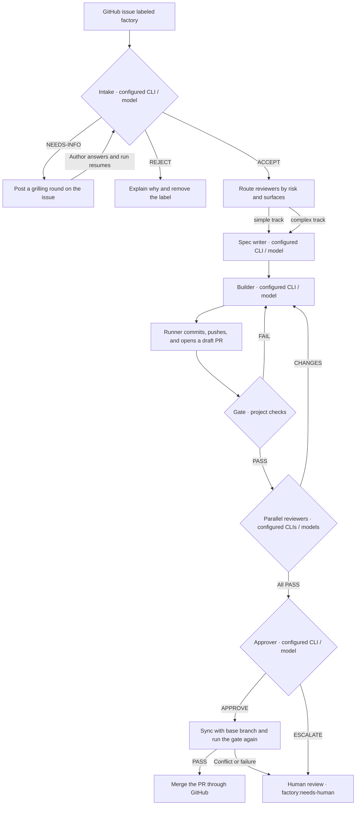

# Software Factory

Build GitHub issues through a repeatable pipeline, using your Claude Code and
Codex subscriptions. Pick a CLI and model independently for intake, specs,
building, reviews, and approval. A shared Python runner handles job state,
worktrees, checks, PRs, and merging.

## Install

Open Claude Code or Codex in the project you want the factory to work on and ask:

```text
Install this software factory in this project from:
https://github.com/sebastiaofv/software-factory
Follow INSTALL.md and configure the project's real checks.
```

You need Python 3.9+, Git, an authenticated [GitHub CLI](https://cli.github.com/),
and whichever coding CLIs your selected profiles use. The default configuration
uses both Claude Code and Codex. Sign in with your subscription accounts using
`claude auth login` and `codex login`. No model API integration is needed.

Run `factory/bin/factory doctor` after installation. This reference repo leaves
`factory/checks.sh` as a failing installer template: configure the target
project's real checks before running jobs. Tests for the factory itself are
separate: `python3 -m unittest discover -s factory/tests -v`.

## The loop



The workflow borrows from [Matt Pocock's skills](https://github.com/mattpocock/skills):
intake **grills** the author on the issue before anything is built, the domain
glossary and ADRs keep the project's language consistent, the builder works
**test-first** in vertical slices, the code reviewer checks the Spec and
Standards axes separately, and specs design **deep modules** behind few seams.

Intake puts each accepted job on one of two tracks. The **simple** track (by
default only low-risk work) gets a short brief and light grilling. The
**complex** track gets grilled until every open decision is settled, and its
spec designs the modules, test seams, slices, glossary and ADR changes before
the builder starts. Both tracks share the same stages and reviewers.

Grilling happens on the GitHub issue. Each round is one comment, `Factory
grilling: round k`, with numbered questions and a recommended answer for each.
Answer in a comment, by number or with "go with your recommendations", then
rerun the factory: it rereads the issue and continues. After
`max_grill_rounds` rounds, intake must accept with its recommended answers or
reject.

Failed checks and requested changes return to the builder up to `max_rounds`;
after that, the job goes to a human. A blocked builder also escalates.
The runner runs up to `concurrency` jobs at once. Reviewers within each job run
in parallel. Each job gets its own `.worktrees/<job-id>` checkout.

## Commands

Label an open issue `factory`, then run from the repository root:

```bash
factory/bin/factory doctor       # configuration, logins, and installation
factory/bin/factory run          # drain the queue; also resume interrupted jobs
factory/bin/factory run 12       # one issue
factory/bin/factory status       # local jobs and usage
```

In Claude Code, use `/factory run` or `/factory run 12`. In Codex, invoke the
factory skill with `$factory` and ask it to run the queue or issue 12. Both
entry points execute the same runner; the host chat does not determine which
CLI builds or reviews the job.

Give feedback on an escalated job through either skill, or use
`factory/bin/job feedback <issue>` with your feedback on stdin and then rerun
that issue. Reject a waiting job with `factory/bin/job reject <issue>` and a
reason on stdin. You can also approve an escalated PR by merging it on GitHub.

## Choose CLIs and models

`factory/config.json` defines named profiles. Each profile selects `claude` or
`codex`, an optional model, and optional `reasoning_effort`. A null model or
effort uses that CLI's current default. Choose models available to your account.
Claude profiles accept `low`, `medium`, `high`, `xhigh`, or `max` (passed as
`claude --effort`); Codex profiles accept `none`, `minimal`, `low`, `medium`,
`high`, `xhigh`, `max`, or `ultra` (passed as `model_reasoning_effort`).

```json
{
  "profiles": {
    "claude-strong": { "cli": "claude", "model": "opus", "reasoning_effort": "high" },
    "codex": { "cli": "codex", "model": null, "reasoning_effort": null }
  },
  "steps": {
    "intake": "codex",
    "spec-writer": "codex",
    "builder": "claude-strong",
    "approver": "codex"
  },
  "routing": {
    "low": { "code": "codex" },
    "medium": { "code": "codex" },
    "high": { "code": "claude-strong" }
  },
  "surface_reviewers": {
    "ui": { "ux": "codex", "ui": "codex" },
    "security": { "security": "claude-strong" }
  }
}
```

This is the profile and routing portion of the configuration; retain the other
settings. For a single subscription, point every step and reviewer at a profile
using that CLI. Another CLI requires an adapter that implements authentication,
command construction, and result parsing in `factory/lib/adapters.py`.

## Dashboard

```bash
python3 -m http.server --bind 127.0.0.1 --directory factory 8000
```

Open <http://localhost:8000/dashboard.html>. Inspect each job's stages, routed
profiles, usage, check results, and review documents. To view the included
historical examples, copy `examples/jobs/` to `factory/jobs/` in a fresh checkout.

The runner stores native CLI output, prompts, and execution receipts under
`factory/jobs/<id>/runs/`. Token usage and any available API-equivalent estimate
are separate from subscription billing. Codex does not report a dollar estimate
in the supported JSON event stream, so mixed runs show an unavailable estimate
instead of treating missing cost as zero. Historical examples retain their
recorded estimates.

## What's in here

```text
.agents/skills/factory/     shared Codex skill and workflow entry point
.claude/skills/factory/     Claude Code entry point to the same workflow
factory/
  bin/factory              runner commands: run, doctor, status
  bin/job                  job state transitions and GitHub side effects
  bin/gate                 deterministic checks in a job's worktree
  bin/route                risk and surfaces → execution profiles
  lib/                     configuration, subscription CLI adapters, scheduler
  prompts/                 provider-independent role instructions
  config.json              profiles, routing, concurrency, timeouts, guardrails
  checks.sh                project checks; filled in during installation
  dashboard.html           local job board
  tests/                   temporary-repository tests with fake coding CLIs
examples/jobs/             historical example artifacts
INSTALL.md                 installation and upgrade instructions
DESIGN.md                  execution design, permissions, and recovery limits
```

## Subscriptions and permissions

- Claude Code must report a first-party subscription account; Codex must report
  ChatGPT login. The adapters refuse detected API-key/provider environment
  overrides. Your provider's account limits and extra-usage settings still apply.
  The factory cannot enforce a subscription's spending cap or verify entitlements
  for every selected model.
- Claude runs noninteractively with file tools and shell commands allowed;
  permission prompts are denied. Codex uses its workspace-write sandbox, the
  job directory as an additional writable directory, and network access enabled
  for project checks. Neither adapter adds a sandbox-bypass flag. Organization
  policy and existing CLI configuration may still restrict tools.
- These CLIs execute repository code with your local account's access. Keep
  production secrets out of the execution environment. Test UI changes with an
  installed `agent-browser` CLI as described in the review prompts.
- Only open issues labeled `factory` start. Agents write bounded role artifacts;
  the runner owns commits, pushes, PRs, and state transitions. The gate reruns
  project checks before review and after syncing for merge.
- Runs open and may merge real PRs. Start with `concurrency: 1`, inspect the
  results, and tailor escalation rules in `factory/prompts/approver.md`.
